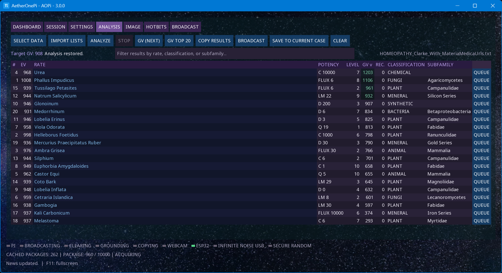
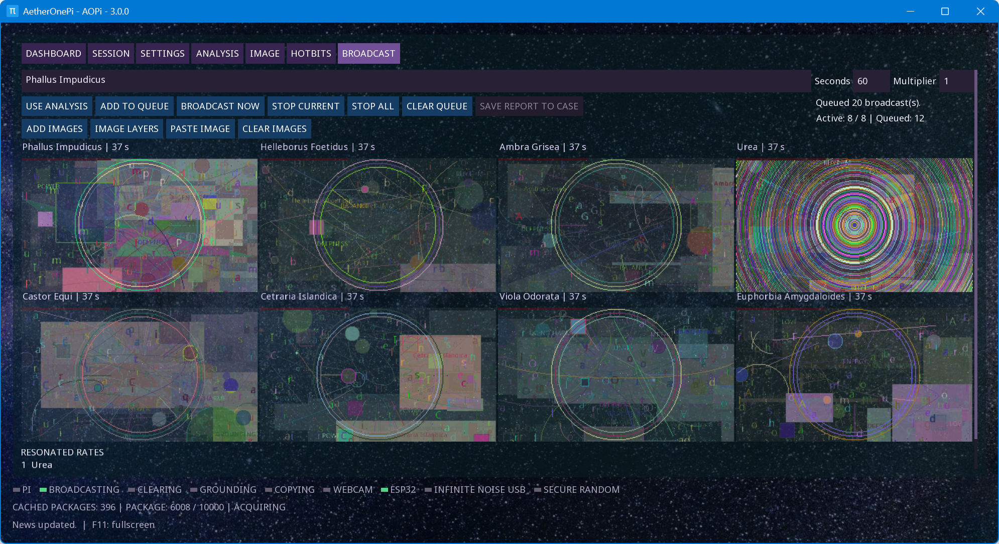

# AetherOnePi 
Open Source Radionics

If you like the project, please **spread the word, promote it** by sharing it with your friends, colleagues and family. **Just don't keep it for yourself.** The more people use it, the more we can improve it together. Visit our community site on [Patreon](https://www.patreon.com/c/aetherone).

# More Resources

## Blogs and Communities
- [Radionics, The Science of Nonlocality and Synchronicity](https://radionics.home.blog)
- [Open Source Radionics on Youtube](https://www.youtube.com/@opensourceradionics)
- [Digital Radionics on Reddit](https://www.reddit.com/r/digitalradionics/)